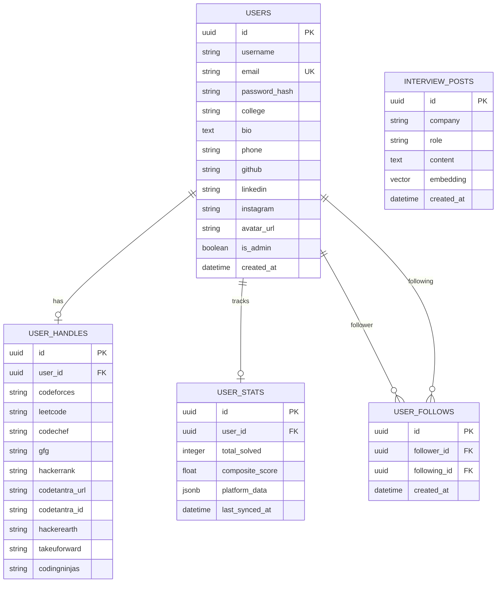

# Industry Grade AI — Competitive Programming Analytics & Career Intelligence Platform

> **Production-grade full-stack intelligence platform that aggregates 9 competitive programming judges, computes standardized composite ratings, powers FAANG interview vector RAG guidance, enables social networking, and offers a superuser governance console.**

---

## 1. Executive Summary

In today's tech hiring landscape, software engineering candidates practice across multiple judges:
- **Algorithms & Contests**: LeetCode, Codeforces, CodeChef, HackerEarth
- **Curated Interview Sheets**: TakeUForward (Striver's A2Z DSA Sheet)
- **Course & Practice Portals**: Coding Ninjas (CodeStudio), GeeksforGeeks, HackerRank
- **Academic & College Portals**: CodeTantra

Evaluating a candidate's actual competency across fragmented platforms is challenging. **Industry Grade AI** solves this by:
1. **Asynchronous Concurrent Scraping**: Concurrently queries all 9 platforms with fault isolation and per-scraper timeout boundaries.
2. **Normalized Composite Scoring**: Standardizes varying difficulty levels, problem counts, and contest ratings into a balanced composite score.
3. **Real-time Global & Campus Leaderboards**: Ranks coders globally and within their specific college campuses.
4. **AI Vector RAG Career Intel**: Grounded interview preparation answers using pgvector cosine embeddings and Google Gemini 3.1 Flash Lite.
5. **Developer Social Networking**: Public profile showcases, live follow/unfollow connectivity, contact sharing (Email, WhatsApp, Phone), and social badges (GitHub, LinkedIn, Instagram).
6. **Superuser Admin Governance**: System KPI analytics, candidate directory search, role management, user editing, and manual handle re-sync triggers.
7. **Dual-Theme Obsidian / Light UI**: Adaptive themes with instant toggle and zero-flash persistence.

---

## 2. System Architecture

```
                                  +-----------------------------+
                                  |     Modern Responsive UI    |
                                  | (Vanilla JS, CSS Variables) |
                                  +--------------+--------------+
                                                 |
                                                 | HTTPS / REST (JSON)
                                                 v
                                  +-----------------------------+
                                  |     FastAPI ASGI Backend    |
                                  |  (Python 3.10+, Uvicorn)    |
                                  +--------------+--------------+
                                                 |
                     +---------------------------+---------------------------+
                     |                           |                           |
                     v                           v                           v
       +---------------------------+ +-----------------------+ +---------------------------+
       |   9-Platform Fetchers     | |   SQLAlchemy 2.0 Async| |     Gemini AI Vector RAG  |
       |  (httpx, Async Scrapers)  | |  (PostgreSQL + Vector)| |  (gemini-embedding-001    |
       +-------------+-------------+ +-----------+-----------+ |   gemini-3.1-flash-lite)  |
                     |                           |             +-------------+-------------+
                     | Concurrently Queries      | Persists                  | Embeddings &
                     v                           v                           v Synthesized Guidance
      [LeetCode, Codeforces, CodeChef,    [PostgreSQL 17 DB:          [pgvector 768-dim Index:
       GFG, HackerRank, CodeTantra,       - users, user_handles,       - interview_posts
       HackerEarth, TakeUForward,         - user_stats, user_follows,  - Cosine Distance Query]
       Coding Ninjas]                     - interview_posts]
```

---

## 3. Supported Platforms & Scraper Ecosystem

The platform features an extensible `BaseScraper` contract located in `backend/app/services/scrapers/base.py`. Any failure on a platform never blocks others (fault isolation).

| Platform | Primary Data Extracted | Scraper Strategy | Default Weight |
|---|---|---|---|
| **Codeforces** | Problems solved, Contest Rating | Official REST API (`/api/user.info`, `/api/user.status`) | Solved: 3.0x, Rating: 1.2x |
| **LeetCode** | Problems solved (Easy, Medium, Hard) | GraphQL API (`matchedUser`, `submitStatsGlobal`) | Solved: 2.0x |
| **CodeChef** | Problems solved, Global Contest Rating | HTML Scraper (`/users/{handle}`) | Solved: 2.0x, Rating: 1.0x |
| **GeeksforGeeks** | Total problems solved, Institute rank | Public Profile HTML parser (`/user/{handle}`) | Solved: 1.5x |
| **HackerRank** | Total solved badge points | Public Badges API (`/rest/hackers/{handle}/badges`) | Solved: 1.0x |
| **CodeTantra** | College lab problems solved | Enterprise College Portal scraping | Solved: 1.0x |
| **HackerEarth** | Practice problems solved, Rating | Public Profile parser (`/@{handle}`) | Solved: 1.5x, Rating: 1.0x |
| **TakeUForward (TUF)** | Striver A2Z sheet problems solved | Profile progress parser (`/profile/{handle}`) | Solved: 2.0x |
| **Coding Ninjas** | CodeStudio problems solved, Score | Code360 profile parser (`/profile/{handle}`) | Solved: 1.5x |

---

## 4. Normalized Composite Scoring Algorithm

The composite score balances breadth (problems solved) with depth (contest ratings):

$$\text{Composite Score} = \sum (\text{Platform Solved}_i \times W_{s,i}) + \sum (\text{Platform Rating}_j \times W_{r,j})$$

### Specific Weights Defined in `constants.py`:
- `codeforces_solved`: **3.0**
- `leetcode_solved`: **2.0**
- `codechef_solved`: **2.0**
- `takeuforward_solved`: **2.0**
- `gfg_solved`: **1.5**
- `hackerearth_solved`: **1.5**
- `codingninjas_solved`: **1.5**
- `hackerrank_solved`: **1.0**
- `codetantra_solved`: **1.0**
- `codeforces_rating`: **1.2**
- `codechef_rating`: **1.0**
- `hackerearth_rating`: **1.0**

### Score Tiers:
- **Legendary Grandmaster**: $\ge 4000$ points
- **International Master**: $2500 - 3999$ points
- **Master Tier**: $1500 - 2499$ points
- **Candidate Master**: $800 - 1499$ points
- **Specialist**: $300 - 799$ points
- **Practicing Coder**: $1 - 299$ points
- **Novice Tier**: $0$ points

---

## 5. AI Vector RAG Architecture & Dynamic PDF Ingestion

1. **Multi-Source Embedding & Dynamic Knowledge Base**:
   - **Gemini Embeddings**: Text queries and document chunks are vectorized into 768-dimensional float arrays using `models/gemini-embedding-001` (`output_dimensionality=768`) via Google Gemini REST transport (`transport="rest"`).
   - **Admin PDF Document Ingestion**:
     - Superusers/Admins can upload any company interview guide, DSA cheatsheet, or technical PDF via the Admin Panel.
     - Dual-engine parsing via **PyMuPDF (`fitz`)** with automatic fallback to **pypdf**.
     - Intelligent semantic chunking (800 characters with 120 character overlap, respecting paragraph & sentence boundaries).
     - Fast batch embedding via Gemini, persisted in PostgreSQL `rag_documents` and `rag_document_chunks` with `ON DELETE CASCADE`.
2. **Two-Tier Search Strategy (Knowledge Base First, Gemini Fallback)**:
   - When a user asks an interview or technical question, the system queries both uploaded PDF documents and community interview posts using PostgreSQL pgvector cosine distance (`<=>`):
     ```sql
     SELECT c.content, d.title, d.category, 1 - (c.embedding <=> :query_vector) AS similarity
     FROM rag_document_chunks c
     JOIN rag_documents d ON c.document_id = d.id
     ORDER BY c.embedding <=> :query_vector ASC
     LIMIT 4;
     ```
   - **Tier 1 (Grounded in Uploaded Documents)**: If retrieved chunks meet the similarity threshold (`>= 0.38`), Gemini synthesizes an answer directly grounded in the uploaded PDF context, citing the document titles and categories.
   - **Tier 2 (Gemini General Intelligence Fallback)**: If no uploaded document matches or similarity is below threshold, the query seamlessly routes directly to `models/gemini-3.8-flash` to answer from Gemini's comprehensive programming and interview intelligence.
3. **Response Synthesis**: `models/gemini-3.8-flash` (with fallback to `gemini-3.1-flash-lite` and `gemini-flash-latest`) provides structured, actionable advice with source cards or AI fallback tags. If network quota limits are ever reached, the system gracefully formats the context chunks directly.

---

## 6. Social Networking & Connectivity

- **Profile Customization & 2x2 Platform Grid**:
  - Users can configure their display name, campus institution, bio, contact number/WhatsApp, GitHub URL, LinkedIn profile, Instagram handle, and custom avatar.
  - **Platform Handle Overrides**: Arranged in an ergonomic 2x2 grid layout (2-column pairs: Codeforces + LeetCode, CodeChef + GeeksforGeeks, HackerRank + HackerEarth, TakeUForward + Coding Ninjas, and CodeTantra spanning both columns).
- **Follow & Following System**:
  - Toggling follow creates/destroys records in `user_follows`.
  - Self-following is strictly guarded against (HTTP 400).
  - Real-time counters update on both user cards and public profile popups.
- **LeetCode-Style Followers / Following List Modal**:
  - Clicking on any follower or following count (on Dashboard, Settings profile card, or User Profile modal) opens a modal modeled after LeetCode's network dialog.
  - Dual tabs with live counters: **Followers (N)** and **Following (N)**.
  - Real-time instant search filtering candidates by username or college.
  - Candidate cards showcasing avatar initial, username, college name, problems solved, and composite points.
  - Direct 1-click **Follow / Following** action button with LeetCode/Twitter-style hover state (changes to "Unfollow" in red on hover).
  - Direct navigation to any user's full public profile on card click.
- **Public Profile Modal**: Clickable from candidate rows, podium rankings, and the network modal. Displays contact badges (`mailto:`, `tel:`, WhatsApp chat, GitHub, LinkedIn, Instagram) and clickable judge profile links.

---

## 7. Superuser Admin Governance Console

Admins possess special governance capabilities accessible via the **Admin Panel** tab:
1. **Live Platform Metrics**:
   - Total registered coders
   - Aggregate problems solved across judges
   - Platform-wide average composite score
   - Total social follow relations
   - Distinct universities represented
   - Handle distribution breakdown
2. **User Governance Directory**:
   - Filter by keyword (name, email, campus) or role (Candidates / Admins).
   - **Edit User**: Modify user attributes or promote/demote admin privileges.
   - **Force Sync**: Manually trigger an immediate async fetch of any user's judge profiles.
   - **Delete User**: Safely removes spam accounts (with self-deletion protection).

---

## 8. Theme System (Dark Obsidian & Titanium Slate Light)

- **Theme Engine**: Uses CSS custom properties defined on `:root` and overridden under `[data-theme="light"]`.
- **Cyberpunk Dark Obsidian**: Neon cyan and amber accents on deep void `#06080e` canvas with frosted translucent glass.
- **Refined Titanium Slate Light**: Designed for zero eye strain—replaces blinding white with cool titanium slate canvas (`#e8ecf4`), frosted porcelain cards (`#f8fafc`), crisp slate borders (`rgba(148, 163, 184, 0.28)`), soft gradient banners, and elevated shadows.
- **Toggle Mechanism**: Instant switcher in the navbar toggles between Obsidian Dark and Titanium Slate Light.
- **Persistence**: Remembers preference across reloads via `localStorage.getItem("industry_grade_ai_theme")`.

---

## 9. Database Schema (PostgreSQL 17 + pgvector)



---

## 10. Complete REST API Reference

### Authentication & Self-Profile
| Method | Endpoint | Auth | Description |
|---|---|---|---|
| `POST` | `/api/v1/auth/register` | No | Register new account with username, email, password, college |
| `POST` | `/api/v1/auth/login` | No | Login and obtain JWT bearer access token |
| `GET` | `/api/v1/auth/me` | Bearer | Get authenticated user profile, stats, social links, and counts |
| `PUT` | `/api/v1/auth/profile` | Bearer | Update bio, phone, college, social URLs (GH, LI, IG), and avatar |

### Platform Sync
| Method | Endpoint | Auth | Description |
|---|---|---|---|
| `POST` | `/api/v1/sync` | Bearer | Concurrent fetch across all 9 judges with optional handle overrides |
| `GET` | `/api/v1/sync/status` | Bearer | Get cached platform breakdown and last synced timestamp |
| `GET` | `/api/v1/sync/handles` | Bearer | Retrieve registered judge handle overrides |

### Leaderboards & Public Profiles
| Method | Endpoint | Auth | Description |
|---|---|---|---|
| `GET` | `/api/v1/leaderboard` | Bearer | Global & campus leaderboards ordered by composite score |
| `GET` | `/api/v1/users/{id}/profile` | Bearer | Public candidate profile with handles, socials, and `is_following` |
| `POST` | `/api/v1/users/{id}/follow` | Bearer | Toggle follow / unfollow target user |
| `GET` | `/api/v1/users/{id}/followers` | Bearer | List of followers for user |
| `GET` | `/api/v1/users/{id}/following` | Bearer | List of users being followed |

### AI Career Intel RAG
| Method | Endpoint | Auth | Description |
|---|---|---|---|
| `POST` | `/api/v1/rag/query` | Bearer | Query interview database with semantic vector search & AI summary |

### Admin Governance
| Method | Endpoint | Auth | Description |
|---|---|---|---|
| `GET` | `/api/v1/admin/stats` | Admin | System-wide statistics and platform breakdown |
| `GET` | `/api/v1/admin/users` | Admin | Search, filter by role, and paginate user directory |
| `PUT` | `/api/v1/admin/users/{id}` | Admin | Edit user details or toggle admin privileges |
| `DELETE` | `/api/v1/admin/users/{id}` | Admin | Permanently delete user |
| `POST` | `/api/v1/admin/users/{id}/sync`| Admin | Trigger immediate re-sync of a candidate's handles |

---

## 11. Quick Start & Execution

### Prerequisites
- Python 3.10+
- PostgreSQL 17 (pgvector extension enabled)
- Valid `GEMINI_API_KEY` in `backend/.env`

### One-Click Launch
- **PowerShell**:
  ```powershell
  .\run.ps1
  ```
- **Windows Command Prompt**:
  ```cmd
  run.bat
  ```

### Manual Execution
1. **Start Backend**:
   ```bash
   cd backend
   python -m uvicorn app.main:app --port 8000 --reload
   ```
2. **Start Frontend**:
   ```bash
   cd frontend
   python -m http.server 5500
   ```
3. Open `http://localhost:5500` in your web browser.

